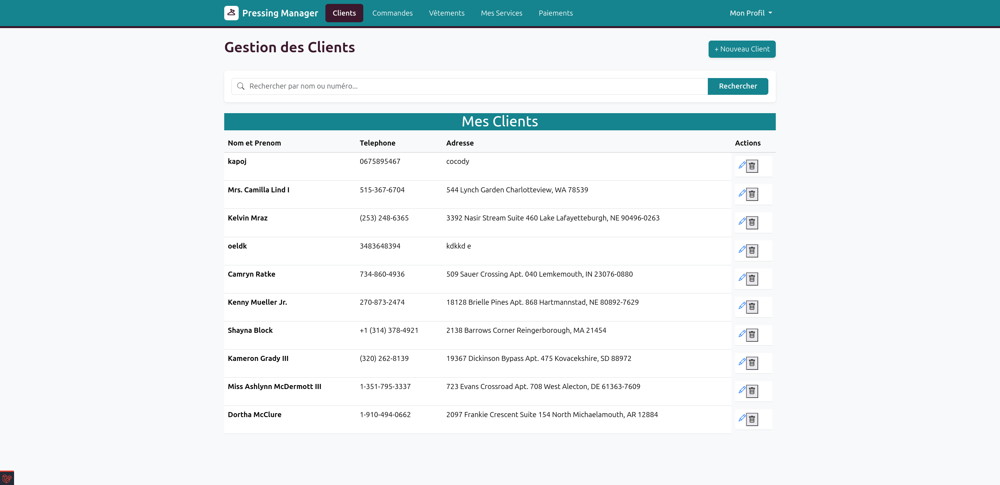
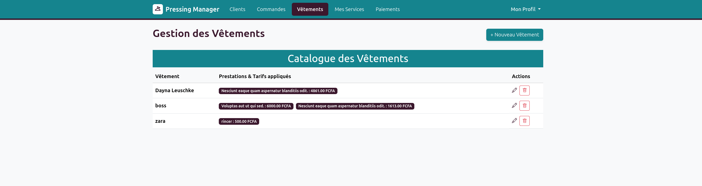
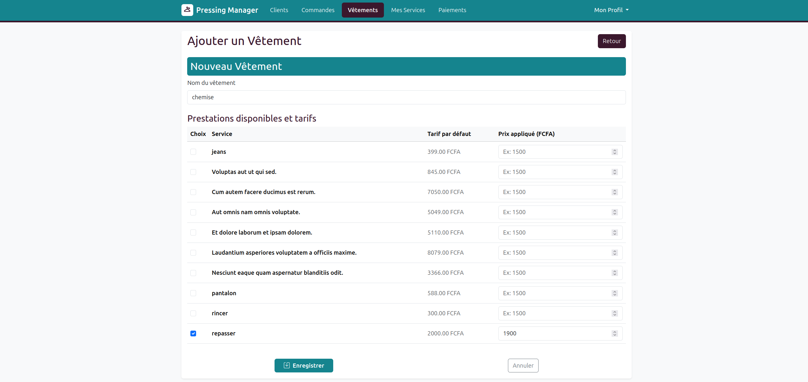
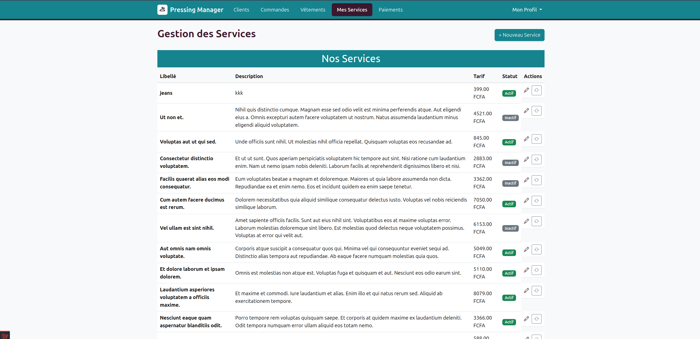
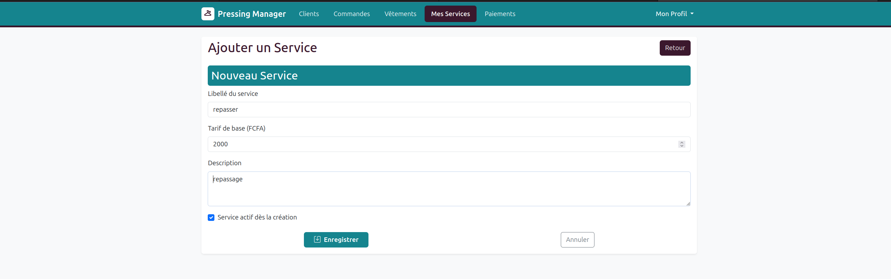
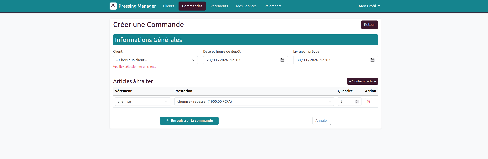
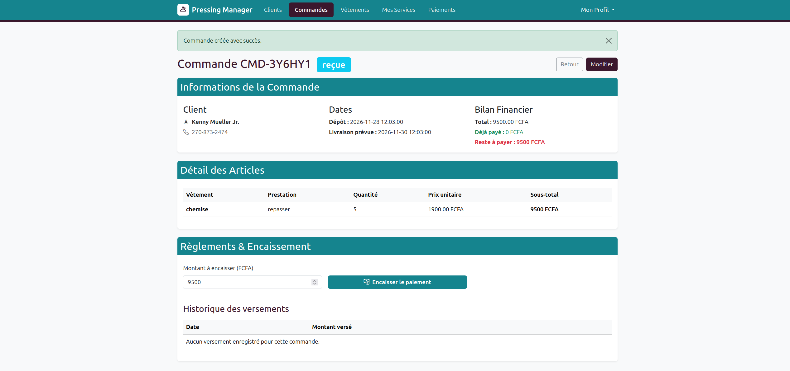
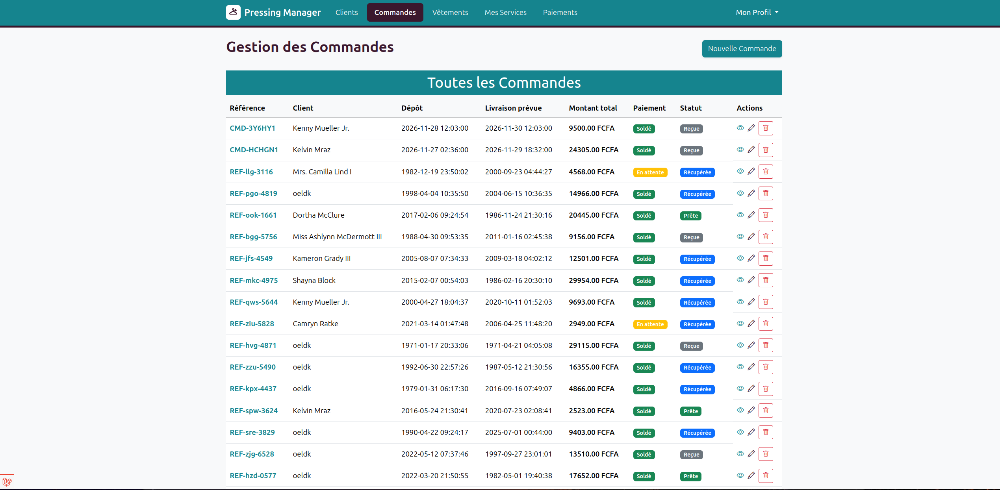

# Pressing Manager

Application web de gestion interne pour un pressing, développée avec Laravel et Bootstrap 5. Elle permet de gérer le fichier clients, le catalogue des vêtements et des prestations, l'enregistrement des commandes multi-lignes ainsi que le suivi des règlements.

---

## Stack technique


---

## Aperçu de l'interface
c
### 1. Gestion des clients
Liste des clients enregistrés avec recherche par nom ou numéro de téléphone et accès rapide aux actions d'édition.


### 2. Catalogue des vêtements
Référentiel des types d'articles pris en charge avec affichage des prestations associées et de leurs tarifs appliqués.


### 3. Ajout d'un vêtement et tarification personnalisée
Association d'un article aux prestations disponibles avec possibilité d'appliquer un tarif spécifique par vêtement.


### 4. Catalogue des prestations et tarifs
Gestion des services proposés (lavage, repassage, nettoyage à sec) avec tarification unitaire en FCFA et activation ou désactivation des offres.


### 5. Ajout d'une prestation
Formulaire de création d'un service avec définition de son tarif de base, sa description et son état d'activation.


### 6. Création d'une commande
Formulaire d'enregistrement d'un dépôt associant un client, les dates de dépôt et de livraison prévue, ainsi que les lignes d'articles et prestations.


### 7. Détail d'une commande et bilan financier
Vue récapitulative affichant les informations du client, le détail des lignes commandées, le calcul du montant total, les versements déjà effectués et le reste à payer.


### 8. Tableau de gestion des commandes
Vue d'ensemble des commandes avec suivi de l'état de paiement, avancement du traitement et actions rapides.


---

## Fonctionnalités

* **Clients :** création, consultation, modification, recherche et suppression des fiches clients.
* **Vêtements et prestations :** administration du catalogue d'articles et des services associés avec gestion de l'état actif ou inactif.
* **Commandes :** génération automatique d'une référence unique (`CMD-XXXXXX`), attribution des dates de dépôt et de livraison prévue, calcul du montant total et suivi de l'avancement (`reçue`, `en traitement`, `prête`, `récupérée`).
* **Suivi des paiements :** affichage du bilan financier par commande (total, montant réglé, reste à payer) et enregistrement des encaissements.

---

## Ce que j'ai appris (Laravel by doing)

Ce projet m'a permis d'acquérir une compréhension concrète du framework Laravel en construisant une application de bout en bout :

* **Migrations :** concevoir, versionner et faire évoluer un schéma de base de données relationnelle avec contraintes de clés étrangères.
* **Modèles Eloquent :** manipuler les relations entre entités (`hasMany`, `belongsTo`, table pivot avec attributs supplémentaires) et sécuriser les écritures via le Mass Assignment (`$fillable`).
* **Contrôleurs :** structurer la logique applicative autour des opérations CRUD et sécuriser les opérations critiques à l'aide de transactions SQL (`DB::transaction`).
* **Validation avec Form Requests :** isoler les règles de validation, les autorisations et les messages d'erreur personnalisés hors des contrôleurs pour garder un code propre et maintenable.
* **Factories et Seeders :** comprendre leur utilité pour générer rapidement des jeux de données réalistes et tester les cas limites sans saisie manuelle répétitive.
* **Moteur de templates Blade :** structurer les vues autour d'un layout principal et de composants réutilisables (`<x-base>`, `<x-navigation>`).

---

## Architecture et choix techniques

* **Architecture MVC :** séparation claire entre les contrôleurs de ressources (`CustomerController`, `ItemController`, `ServiceController`, `OrderController`, `OrderPaymentController`), les modèles Eloquent et les vues Blade.
* **Historisation des tarifs :** la table `order_items` enregistre le prix unitaire appliqué au moment de la commande. Une modification ultérieure des tarifs du catalogue n'altère pas l'historique des commandes passées.
* **Identité visuelle :** intégration sous Bootstrap 5 avec une charte personnalisée (Teal `#15848E` et Violet `#3B182D`) et un logo vectoriel intégré.

---

## Modèle de données

L'application s'appuie sur 6 tables principales :

* `customers` : informations d'identification et de contact des clients.
* `items` : types de vêtements traités.
* `services` : prestations proposées et tarifs de référence.
* `orders` : commandes rattachées à un client, avec référence, dates, statut et montant total.
* `order_items` : lignes de commande liant une commande, un vêtement et un service avec quantité et prix unitaire figé.
* `payments` : versements rattachés à une commande.

---

## Installation en local

1. **Cloner le dépôt et accéder au dossier :**
   ```bash
   git clone [https://github.com/boubacarsow-dev/pressing-manager.git](https://github.com/boubacarsow-dev/pressing-manager.git)
   cd pressing-manager
   ```

2. **Installer les dépendances PHP et frontend :**
   ```bash
   composer install
   npm install
   ```

3. **Configurer l'environnement :**
   ```bash
   cp .env.example .env
   php artisan key:generate
   ```
   Renseigner les accès MySQL dans le fichier `.env` :
   ```env
   DB_CONNECTION=mysql
   DB_HOST=127.0.0.1
   DB_PORT=3306
   DB_DATABASE=pressing_db
   DB_USERNAME=root
   DB_PASSWORD=
   ```

4. **Exécuter les migrations et générer les données de test :**
   ```bash
   php artisan migrate --seed
   ```

5. **Compiler les assets et démarrer le serveur :**
   ```bash
   npm run build
   php artisan serve
   ```
   L'application est accessible sur `http://127.0.0.1:8000`.

---

## Workflow Git et évolutions prévues (v1.1)

Le développement suit une organisation par branches : les fonctionnalités sont développées sur des branches dédiées (`feature/*`), intégrées sur `develop`, puis publiées sur `main`.

Prochaines améliorations prévues pour la version 1.1 :
* Prise en charge complète des acomptes partiels dans `StorePaymentRequest` et calcul du statut soldé basé sur le cumul des versements.
* Blocage du passage au statut `récupérée` tant que le reste à payer est supérieur à zéro.
* Ajout et suppression dynamique de lignes d'articles en JavaScript sur le formulaire de création de commande.